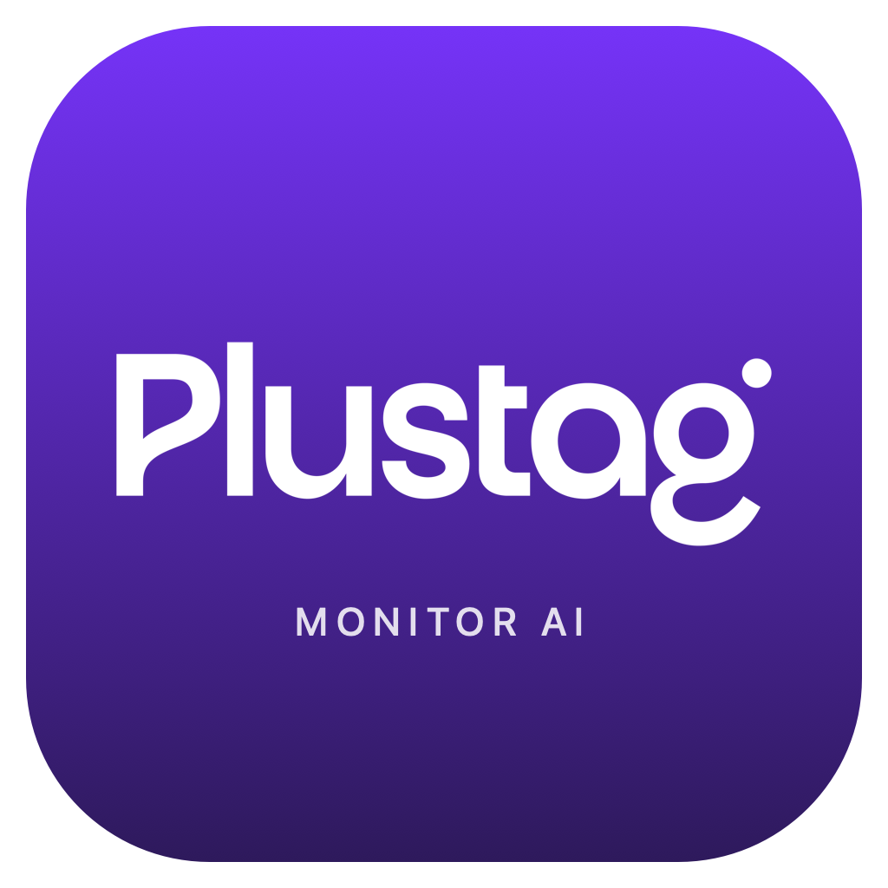

# Plustag Monitor AI



Tus límites de IA, a la vista. Una aplicación nativa para Mac, con ventana flotante, vista compacta y acceso desde la barra de menú.

## Descargar e instalar

Ve a **[la última versión](https://github.com/lopezlab13/plustag-monitor-ai/releases/latest)** y descarga el archivo **Plustag-Monitor-AI-0.1.0-macOS-arm64.zip** de **Assets**. No necesitas descargar el código ni instalar Xcode para usar la aplicación.

Luego sigue la **[guía de instalación para el equipo](docs/INSTALACION.md)**.

La descarga está preparada para Mac con Apple Silicon (chips de la serie M), con macOS 13 o posterior. Validada localmente en macOS 27.0.1; falta probarla en otros equipos y versiones. No se publica un ejecutable para Mac Intel en esta versión.

**Versión inicial con firma local, sin Developer ID ni notarización de Apple.** macOS puede bloquear la primera apertura. La guía explica las opciones del sistema; no hace falta desactivar Gatekeeper ni compartir credenciales.

## Qué muestra

| Fuente | Datos | Cómo se actualiza |
| --- | --- | --- |
| Codex + ChatGPT Work | Cuota disponible y renovación de las ventanas que devuelve la cuenta | Fuente oficial de Codex, cada 5 minutos y al actualizar |
| Claude Desktop | Cuota de sesión, cuota semanal, renovaciones y reparto entre Claude Code, Chats, Cowork y Other | Lectura del panel **Settings → Usage** cada 30 segundos, con permiso de Accesibilidad |
| Chats habituales de ChatGPT | Sin cuota conectada en esta versión | No se estiman datos a partir de Codex |

Codex y ChatGPT Work comparten límites. La fuente usada no separa el consumo de cada producto. En Claude, el reparto por producto es participación en el uso semanal; no equivale a cuota disponible.

Claude necesita tener su pantalla **Usage abierta**. Si vuelves a tus chats o cierras Claude, el monitor conserva la última lectura y avisa que no se ha actualizado. La hora «Leído» se refiere a la lectura de pantalla; también se muestra la antigüedad que informe Claude cuando está disponible.

## Uso diario

- Cambia entre **OpenAI** y **Claude** en la vista compacta.
- Desplázate dentro de la ventana para ver el detalle completo.
- Pulsa **Ampliar** o **Vista compacta** para cambiar de tamaño.
- Usa el gráfico de la barra de menú para mostrar la ventana, actualizar o salir.
- Cerrar la ventana mantiene el monitor activo en la barra de menú.

## Cuentas y privacidad

Cada persona usa sus propias cuentas de OpenAI y Claude. La descarga no incluye sesiones, tokens, contraseñas ni datos de uso del creador del proyecto.

La aplicación no ejecuta prompts de IA para consultar límites. Codex gestiona su propia autenticación; el monitor no lee sus archivos de credenciales. La integración de Claude usa Accesibilidad, un permiso amplio de macOS, y su código se limita a leer el panel de uso del proceso oficial de Claude. No escribe en Claude ni lee campos de conversación. Los datos de Claude permanecen en memoria y se borran al desconectar o cerrar el monitor.

Más detalle: **[Claude y fuentes de datos](CLAUDE.md)**. El widget nativo está preparado como trabajo pendiente; no se incluye en la descarga flotante: **[estado de WidgetKit](WIDGET.md)**.

## Compilar desde el código

Requiere las Command Line Tools de Apple y Swift 5.9 o posterior. En un Mac Intel, la compilación genera una app Intel, pero aún no se ha validado en ese hardware.

```sh
git clone https://github.com/lopezlab13/plustag-monitor-ai.git
cd plustag-monitor-ai
./scripts/build.sh
open "dist/Plustag Monitor AI.app"
```

Si no tienes las herramientas de Apple, instala las Command Line Tools con `xcode-select --install` y completa su instalación antes de compilar. También puedes abrir `Package.swift` con Xcode. Para la extensión de widget existe `PlustagMonitor.xcodeproj`; necesita configuración adicional de firma y App Group.

## Verificar y generar una descarga

```sh
./scripts/check.sh
./scripts/package-release.sh
```

Las verificaciones locales prueban porcentajes, datos ausentes, compatibilidad con múltiples cuotas y la lectura de textos de Claude. `./scripts/check.sh --live` agrega una consulta real de Codex usando la sesión propia de ese Mac; no se ejecuta en GitHub Actions.

El empaquetado genera un ZIP, la guía de instalación y `SHA256SUMS.txt` dentro de `release/`. No reemplaza la copia de `dist/` que tengas abierta. La automatización de GitHub verifica y compila el código; no distribuye credenciales ni firma como desarrollador verificado.

## Proyecto

SwiftUI y AppKit, sin dependencias de terceros. Es independiente de Plustag Intelligence. El logo y los colores corresponden a Plustag. No es una aplicación oficial de OpenAI ni de Anthropic.

No se ha añadido una licencia de código abierto. La publicación del código no concede una licencia adicional sobre la marca Plustag.

Fuentes: [Codex app-server](https://learn.chatgpt.com/docs/app-server), [cuotas compartidas de Work y Codex](https://learn.chatgpt.com/docs/pricing), panel **Claude → Settings → Usage**.
